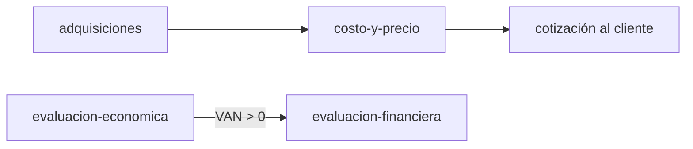

# Grafo de ingeniero-agentico

Tres clases de nota, enlazadas entre sí. Ábrelo en Obsidian (vista de grafo) o córrele
`graphify` a la carpeta del repo.

- **Métodos**: lo que se ejecuta. [[adquisiciones]] · [[costo-y-precio]] ·
  [[evaluacion-economica]] · [[evaluacion-financiera]]
- **Ramos**: de dónde sale cada método. [[gestion-de-operaciones]] · [[analisis-de-datos]] ·
  [[contabilidad-y-costos]] · [[optimizacion]] · [[bases-de-datos]] · [[finanzas]] ·
  [[gestion-de-procesos]] · [[visualizacion-de-la-informacion]] · [[gestion-de-proyectos]] ·
  [[metodos-agiles]] · [[evaluacion-de-proyectos]] · [[economia]]
- **Patrones**: la forma que se repite entre métodos. [[comparar-y-decidir]] ·
  [[consolidar-verdad-dispersa]] · [[emitir-documento-formal]]

- **Etapas**: cómo se orquesta un encargo (ver `ARQUITECTURA.md`). `orquestar` →
  `cartografiar` → `investigar` → métodos → `auditar`.

## Cadenas

