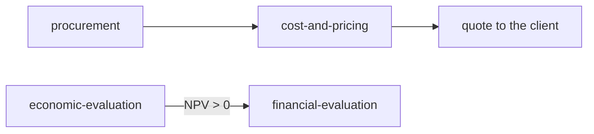

# ingeniero-agentico graph

Three kinds of note, linked to each other. Open it in Obsidian (graph view) or run
`graphify` on the repo folder.

- **Methods**: what gets executed. [[procurement]] · [[cost-and-pricing]] ·
  [[economic-evaluation]] · [[financial-evaluation]]
- **Courses**: where each method comes from. [[operations-management]] · [[data-analysis]] ·
  [[cost-accounting]] · [[optimization]] · [[databases]] · [[finance]] ·
  [[process-management]] · [[information-visualization]] · [[project-management]] ·
  [[agile-methods]] · [[project-evaluation]] · [[economics]]
- **Patterns**: the shape that repeats across methods. [[compare-and-decide]] ·
  [[consolidate-scattered-truth]] · [[issue-formal-document]]

- **Stages**: how a task is orchestrated (see `ARCHITECTURE.md`). `orchestrate` →
  `map-context` → `research` → methods → `audit`.

## Chains

